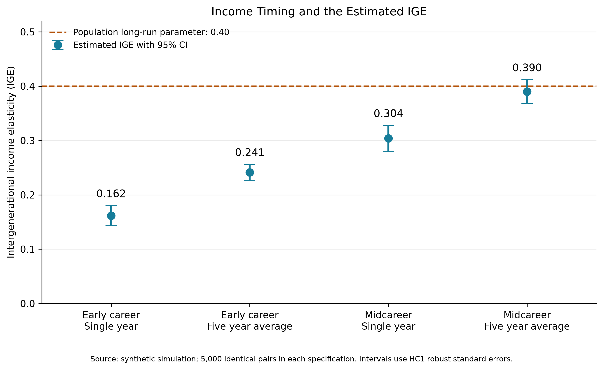

# Blog Post 6: Matching Parents and Children with SQL in Python

This project uses SQLite within Python to match parents and children,
construct income measures, and estimate intergenerational income
elasticity (IGE).

## Data source

All data are synthetic and generated by `analysis.py`.
No real survey records or personal information are used.

The simulation contains 5,000 families, with one designated parent and
one child per family. Each person has a permanent person ID and a stable
origin-family ID.

Parents are observed at ages 38–42, and children at ages 25–45.
Income is generated in constant hypothetical dollars.

The random seed is 62026. The population elasticity between latent
long-run incomes is set to 0.40. This is a simulation assumption,
not an empirical finding.

Annual income contains independent temporary shocks. Children's
early-career income reflects long-run income differences less strongly
than their midcareer income.

## Project structure

- `analysis.py`: generates data, runs SQL queries, estimates IGE,
  and saves results.
- `sql_practice.py`: introductory SQL exercises.
- `data/people.csv`: individual identifiers, origin-family identifiers,
  and parent/child roles.
- `data/income.csv`: annual individual income and age.
- `results/matched_*.csv`: matched income samples.
- `results/ige_estimates.csv`: estimates, HC1 robust standard errors,
  and approximate 95% confidence intervals.
- `results/ige_comparison.png`: comparison figure.
- `requirements.txt`: Python package versions.
- `.gitignore`: excludes local environment files from Git.

## Requirements

The project was run with Python 3.13.5.

SQLite is accessed through Python's built-in `sqlite3` module.
Matplotlib is used for plotting.

## Reproduce the analysis

Open a terminal in this project folder.

Create and activate a virtual environment on macOS:

```bash
python3 -m venv .venv
source .venv/bin/activate
```

Install the dependencies and run the analysis:

```bash
python -m pip install -r requirements.txt
python analysis.py
```

The script regenerates the synthetic data and overwrites its generated
results. The SQLite database exists in memory during execution.

## Methods

SQL joins parents and children using their origin-family IDs and roles.
Individual IDs connect each person to annual income records.

Income is aggregated before joining the parent and child summaries,
preventing an accidental many-to-many join across years.

The analysis takes the natural logarithm of arithmetic mean income,
then estimates OLS with an intercept:

log(child income) = alpha + beta * log(parent income) + error

The slope beta is the IGE. Standard errors use the HC1
heteroskedasticity-robust formula.

Each income window must contain all required annual observations.
All four specifications use the same 5,000 children.
The script checks sample sizes and duplicate child matches.

## Results

| Specification | Parent ages | Child ages | IGE |
|---|---|---|---:|
| Early career, single year | 40 | 25 | 0.162 |
| Early career, five-year average | 38–42 | 25–29 | 0.241 |
| Midcareer, single year | 40 | 40 | 0.304 |
| Midcareer, five-year average | 38–42 | 38–42 | 0.390 |



## Interpretation and limitations

Holding parental single-year income fixed, changing the child's
measurement age from 25 to 40 raises the estimated IGE.
This illustrates life-cycle bias in the simulated setting.

Averaging reduces temporary income fluctuations, but averaging only
early-career observations does not eliminate age-related distortion.
The five-year early-career window also changes the child's measurement
ages, so its difference from the age-25 estimate does not isolate
averaging alone.

These estimates are descriptive associations, not causal effects.
They demonstrate the simulation's assumptions and do not measure
mobility in any actual population.

All simulated incomes are positive and complete. Real applications
require documented treatment of inflation, missing income, nonpositive
income, and verified parent-child relationships.
A shared household ID alone does not establish parenthood.